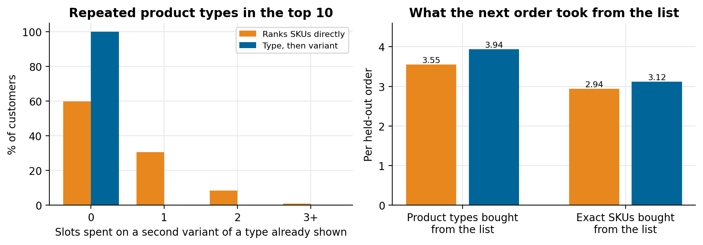
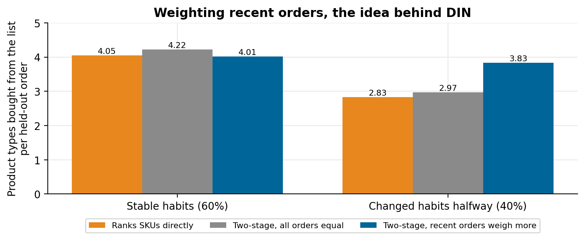

# Two-stage grocery recommender

A grocery recommender that picks the product type first and the variant second, so the list never shows two sizes of the same thing.

Companion code for the article **[A two-stage recommender for grocery e-commerce](https://lucas.rangeltech.net/articles/h4-two-stage-recommender-grocery/)**.

## The problem

Ask a standard recommender what a grocery customer will buy next and it may answer olive oil three times: the 1-litre, the 750 ml and the store brand, because each is a separate SKU with its own history.

This repository compares a SKU ranker with a two-stage design on synthetic orders: 80 product types with 2 to 5 variants each, 2,000 customers with 14 orders each (the last one held out), and 40% of customers changing habits halfway through.

> All data in this repository is synthetic, generated by the scripts with a fixed seed, with the shape of a real client problem. No client data, names or code are included.

## What the code does

- **SKU model:** ranks SKUs by the customer's purchase counts, smoothed by popularity.
- **Two-stage model:** stage 1 ranks product types with recency-weighted counts (a three-order half-life, the idea Deep Interest Network learns with attention); stage 2 picks one variant per type: the customer's usual one, or for a new type the highest-margin variant among those nearly as popular as the best.
- **Batch contract:** `export()` writes one JSON per tenant and slot with a ranked list per customer (`sample_output.json`).

In production the two stages were DeepFM and DIN; counts stand in for them here so the structure is visible and it runs in seconds.

## Results

| Per held-out order | SKU model | Two-stage, all orders equal | Two-stage, recent orders weigh more |
|---|---:|---:|---:|
| Lists showing a product type twice | 40% | 0% | 0% |
| Product types bought from the list | 3.55 | 3.71 | 3.94 |
| ... customers who changed habits | 2.83 | 2.97 | 3.83 |
| ... customers with stable habits | 4.05 | 4.22 | 4.01 |





## Run it

Python 3.11 or later.

```bash
pip install -r requirements.txt
python simulate.py
python figures.py figures
```

## Files

| File | What it is |
|---|---|
| `simulate.py` | catalogue, customers, orders, the three models, metrics and the JSON export |
| `figures.py` | repeated types and the effect of recency |
| `sample_output.json` | one customer's batch output |

## License

Apache 2.0. See [LICENSE](LICENSE).
